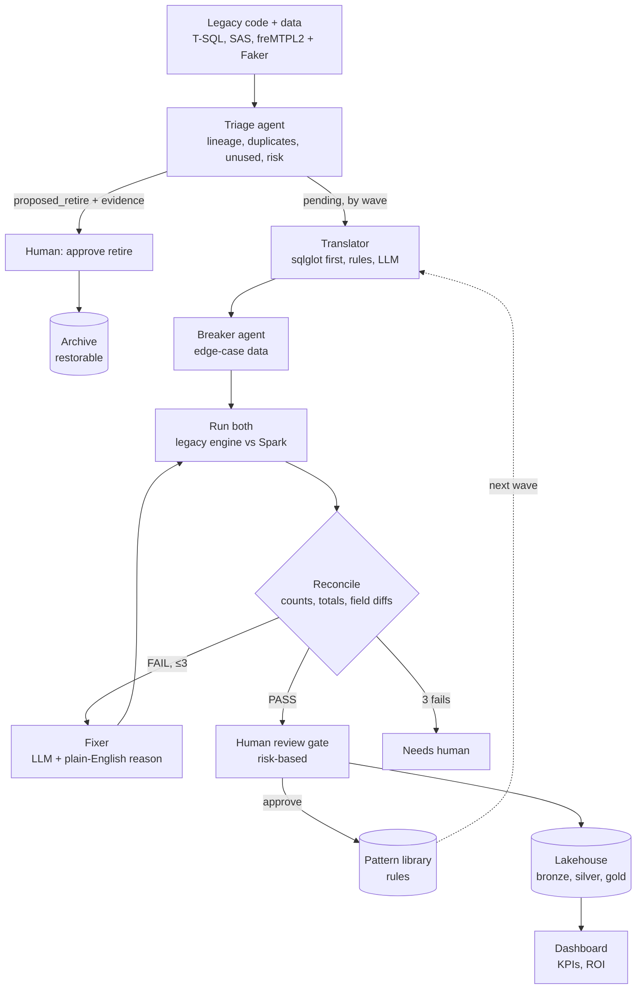

# Architecture

| Component | Code | Tech |
|---|---|---|
| Data builder | `factory/data_gen/` | pandas, Faker |
| Runners | `factory/runners/` | SQL Server / emulator, PySpark / DuckDB |
| Triage | `factory/triage/` | sqlglot, networkx |
| Translator | `factory/translate/` | sqlglot, LLM |
| Breaker | `factory/breaker/` | Python, LLM |
| Reconciler | `factory/reconcile/` | pandas |
| Agent loop + fixer | `factory/agents/` | Python, LLM |
| Pattern library | `factory/patterns/` | sqlglot AST rewrites |
| Archive | `factory/archive/` | Parquet |
| Registry + audit | `factory/registry.py` | SQLite |
| App | `app/` | Streamlit |

One-page submission diagram: [`docs/architecture.png`](architecture.png) (also `architecture.pdf`, `architecture.svg`).
